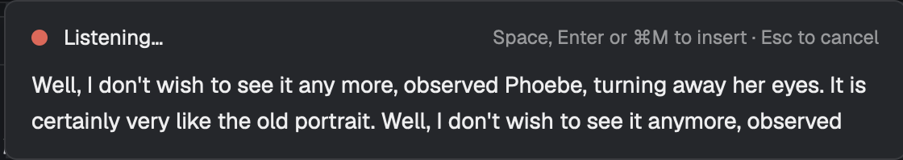

# Dictate for Herdr

Local, live voice-to-text into any Herdr terminal. Press ⌘M, talk, press ⌘M
again: the text is pasted at the prompt (Enter is not pressed). Transcription
runs on your Mac with Parakeet TDT v3 (parakeet-mlx) and Silero VAD; nothing is
sent anywhere.



See [RECIPE.md](RECIPE.md) for the full behavior and how it's built.

## Requirements

macOS on Apple silicon, Herdr, [Homebrew](https://brew.sh) and [uv](https://docs.astral.sh/uv/).

```sh
brew install ffmpeg
uv tool install parakeet-mlx --with onnxruntime
# The speech model, about 2.5 GB, downloaded once:
HF_HUB_DISABLE_XET=1 ~/.local/share/uv/tools/parakeet-mlx/bin/hf download mlx-community/parakeet-tdt-0.6b-v3
```

## Install

Ask your Herdr agent to add this mod from its GitHub URL, or by hand:

1. Copy `mods/dictate` (and `mods/dictate-button` for the mic button) into
   `~/.config/herdr-app/mods/`.
2. Merge `keys.json` into `~/.config/herdr-app/keys.json`. ⌘M replaces macOS
   Minimize while Herdr has focus; use another key if you rely on it.
3. `herdr-app check ~/.config/herdr-app/mods/dictate`
4. Press ⌘M. macOS asks once for microphone access.

### Mic button (optional)

The button floats over the terminal area, so it goes in a layout. Clone your
layout (`herdr-app do layout.clone`), and in the clone add this to the block
that shows terminals (`"id": "main"` in Herdr's `main` layout):

```json
"floating": [
  { "id": "dictate-button", "content": { "mod": "dictate-button" }, "edge": "bottom", "align": "end" }
]
```

## What it runs

The mod runs programs on your Mac: `ffmpeg` (microphone), parakeet-mlx's Python
with `mods/dictate/live.py` (transcription), and `pbcopy`, `kill` and `ps`. It
writes temporary files under `~/Library/Caches/herdr-dictate/` and deletes them
when done. It makes no network requests.

## Credits

- [parakeet-mlx](https://github.com/senstella/parakeet-mlx) and NVIDIA's Parakeet TDT 0.6B v3
- [Silero VAD](https://github.com/snakers4/silero-vad) (MIT, bundled in `mods/dictate/models/`)

MIT licensed.
