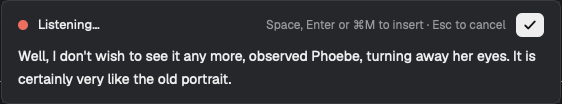

# Dictate

Talk, and the words appear in whichever terminal you were in. Press ⌘M: a small
popup at the bottom of the window starts listening and writes out what you say as
you say it. Press ⌘M, Space or Enter again, or click its check
button, and the text is pasted into the
terminal (without pressing Enter for you). Everything runs on the Mac: Parakeet
TDT v3 on the GPU through parakeet-mlx, with no account and no network. An
optional mic button in the corner of the terminal area does the same with a click.

## What you see

- **Popup** (`mods/dictate`): 560×150, at the bottom of the window, 40px up.
  Background `popover`, text `foreground`, padding 16px sides / 12px top and bottom,
  8px between rows.
  - Top row: a 10px dot, then a 13px semibold title, then a 12px `muted` hint,
    then (only while listening) a 28×24 Done button with 6px corners in the
    theme's primary-button colors (`solid` / `solid_foreground`) holding a 16px
    check mark; hover dims it to 85%.
    - Listening: red dot (`blocked`) pulsing between 30% and 100% opacity every
      second; title "Listening…"; hint "Space, Enter or ⌘M to insert · Esc to cancel".
    - Finishing: `working`-colored pulsing dot; title "Finishing…"; no hint.
    - Failed: steady red dot; title "Dictation failed"; hint "Esc to close".
  - Body, 14px: "Start talking…" in `dim` until there's text. Then the transcript:
    settled text in normal type, followed by the sentence that can still change
    in *italics*. Long dictations show their last 280 characters, starting with
    "…". On failure the body is the error, in `blocked` red.
- **Mic button** (`mods/dictate-button`, optional): a 44×34 button with 7px corners
  and a 20px microphone icon, floating at the bottom right of the terminal
  area. Idle it uses the theme's primary-button colors (`solid` /
  `solid_foreground`). While dictating it turns red (`blocked`, white icon) and
  pulses between 55% and 100% opacity. Hover dims it to 85%. Herdr draws its thin
  floating-block frame around it.

## How it behaves

- ⌘M (anywhere in Herdr) opens the popup and starts listening to the default
  microphone. It remembers which terminal had focus.
- While you talk the italic sentence is re-transcribed about twice a second. At a
  short pause (0.5s) every finished sentence but the last is settled and never
  changes again; the last stays italic, so if you were pausing mid-sentence it
  gets corrected once you go on. After a long pause (1.8s) it settles too.
- ⌘M, Space or Enter in the popup, a click on its check button, or a click on
  the red mic button: the popup
  shows "Finishing…", the rest is settled, the popup closes, the text is pasted into
  the remembered terminal, and it stays on the clipboard. Enter is not pressed.
  If no terminal had focus, a notification says the text is on the clipboard.
- Esc cancels: nothing is pasted, the recording is dropped.
- A recording stops itself at 10 minutes and keeps what was said.
- Clicking the idle mic button opens the popup, same as ⌘M.
- Nothing said: "Heard nothing." Missing setup (ffmpeg, parakeet-mlx, the model)
  or a denied microphone: a one-line error saying what to run or where to allow it.

## Built from

- `mods/dictate/mod.json`: `"place": "none"`, overlay `popup` at `bottom`, offset 40,
  560×150.
- `mods/dictate/main.js` (View): on init takes `focused().terminal`, sets shared
  `dictate.terminal`, and `exec`s `sh` running `live.py` in the background with its
  pid in `~/Library/Caches/herdr-dictate/rec-<ms>.pid` (exec timeout 11 min). Every
  300ms it reads `<base>.partial` (JSON `{committed, open}`) with `readTextFile`
  and checks shared `dictate.finish` (a timestamp newer than its start means
  "stop"). Stop = `kill -INT`, wait for the exec, read `<base>.txt`, `pbcopy` it,
  `closeOverlay(props().overlay)`, `run("pane.focus", {terminal})`,
  `run("terminal.paste")`. `close()` sends `kill -TERM` (cancel). `nextCommand()`
  handles `stop` (bound as `dictate.stop`) and `focus`. The Done button's
  `on_click` calls the same stop (with `cx.stop_propagation()`); its art is
  `check.svg`, a 16×16 stroked check mark using `currentColor`. Transcript drawn with
  `TextView.markdown` from `gpui-base`, markdown characters escaped.
- `mods/dictate/live.py`, run by parakeet-mlx's own Python
  (`~/.local/share/uv/tools/parakeet-mlx/bin/python`):
  - starts `ffmpeg -f avfoundation -i :default` (16 kHz mono s16le to stdout) before
    loading anything, buffering the mic in a thread so the first words aren't lost;
  - loads `mlx-community/parakeet-tdt-0.6b-v3` offline (`HF_HUB_OFFLINE=1`);
  - Silero VAD v5 (`models/silero_vad.onnx`, onnxruntime, 512-sample frames with 64
    samples of context; speech on at 0.5, off below 0.35);
  - settling uses sentence timestamps from `model.generate(get_logmel(...))[0].sentences`,
    cutting the open audio 0.15s before the last sentence's start; open audio is
    capped at 25s;
  - writes `.partial` and `.txt` atomically; SIGINT = finish (exit 0), SIGTERM =
    cancel (exit 130); ffmpeg ending on its own = mic error (exit 1).
- `mods/dictate-button/main.js` (View, `"place": "none"`): reads shared
  `dictate.terminal` to know it's live; click runs `mod.open {name: "dictate"}` or
  sets shared `dictate.finish` to `Date.now()`. Art: `mic.svg`, a 16×16 stroked
  microphone using `currentColor`.
- `keys.json`: global `cmd-m` → `mod.open:dictate`; section `mod:dictate`:
  `cmd-m` → `dictate.stop`.
- Programs: `ffmpeg` (PATH, else `/opt/homebrew/bin` or `/usr/local/bin`),
  `uv`-installed `parakeet-mlx` with `onnxruntime`, `pbcopy`, `kill`, `ps`.

## Watch out

- macOS on Apple silicon only: MLX, avfoundation and `pbcopy`.
- Setup, once: `brew install ffmpeg`,
  `uv tool install parakeet-mlx --with onnxruntime`, then download the model
  (2.5 GB): `HF_HUB_DISABLE_XET=1 ~/.local/share/uv/tools/parakeet-mlx/bin/hf download mlx-community/parakeet-tdt-0.6b-v3`.
  Without `HF_HUB_DISABLE_XET=1` the download stalled. live.py loads the model
  offline on purpose, so a missing model is an error, not a silent 2.5 GB download.
- macOS asks for microphone access for Herdr the first time.
- Load ffmpeg and the mic before importing MLX: the model takes a second or two to
  load, and speech in that window would otherwise be lost.
- Herdr doesn't always end exec'd programs when a mod's view goes away (a reload
  after editing `main.js`): `close()` never runs and the recorder keeps the mic
  open. live.py checks every second whether its `sh` parent has been handed to
  launchd and cancels itself if so, and stops itself after 10 minutes either way.
- `exec` is capped at 10 minutes, so dictations are too.
- ⌘M replaces macOS Minimize while Herdr has focus. Pick another key in `keys.json`
  if you use it.
- Pasting goes through the clipboard (Herdr has no "type text without Enter"
  command), so dictating replaces what's on the clipboard.
- The mic button needs a layout with a `floating` entry (see the README); a mod
  alone can't add it. Its frame comes from Herdr: `"frame": "none"` and
  `colors` on the floating entry were both ignored.
- One-shot transcription of a whole clip takes about 1.1–1.5s, so the italic
  sentence lags speech by about that much.

## Done when

- `herdr-app check mods/dictate` and `herdr-app check mods/dictate-button` pass.
- ⌘M in a terminal shows "Listening…" with a pulsing red dot; speaking fills
  the body within about a second.
- After a pause mid-sentence, then finishing the sentence, the italic part
  corrects itself and the earlier sentences don't change.
- ⌘M again, or a click on the check button, pastes the text at the terminal's prompt without running it, and
  `pbpaste` prints the same text.
- Esc closes the popup, nothing is pasted, and `pgrep -f dictate/live.py` prints
  nothing.
- With the button in the layout: it turns red and pulses while the popup is
  listening, and clicking it pastes like ⌘M.
- Without ffmpeg on the machine, the popup says "ffmpeg not found. Install it:
  brew install ffmpeg".
